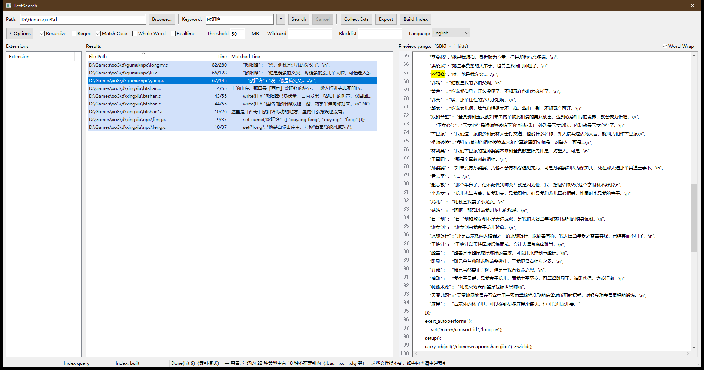

# TextSearch — CJK-first local full-text search (GUI + CLI + inverted index)

**English | [简体中文](README.zh-CN.md)**

TextSearch is a small, fast, dependency-free full-text search tool for Windows
that treats **plain text as a first-class citizen** — source code, config
files, logs, notes, Markdown — in any mix of **UTF-8 / GBK / UTF-16**, with
Chinese content handled natively rather than as a byte stream.

## Why this one

- **Plain-text focus.** It indexes exactly what Notepad can open (`.py .c .h
  .ini .yaml .json .md .log …`) and deliberately nothing else. No PDF/DOCX
  parsing, no bundled everything-engine — in exchange: tiny, fast, auditable.
- **Two search modes, one tool.** *Realtime scan* (thread pool + 64 MB
  sliding memory-map window, bounded memory on huge files) for one-off
  searches; a persistent *inverted index* for directories you search
  repeatedly — build once, query in milliseconds, with automatic incremental
  updates before every search.
- **CJK is a first-class citizen.** Chinese bi-gram tokenization with
  adjacency verification, plus sub-token 3-gram recall: searching `rdp`
  finds it inside `wizardp`, and Chinese substrings never silently miss.
  Encodings are auto-detected (UTF-8/GBK/UTF-16, BOM or not).
- **Zero dependencies, zero telemetry.** Win32-native three-pane GUI plus a
  cross-platform CLI (`textsearch-cli`). No third-party libraries (even the
  JSON/INI parsers and the test framework are in-tree), no installer, no
  phone-home. **Search keywords are never written to disk** — hard guarantee,
  no opt-in required.



## Features

- Substring / ECMAScript regex / case-sensitive / whole-word matching
- Dual mode: realtime scan ↔ persistent inverted index, auto-routed (force
  either one for A/B comparison)
- Incremental index update (mtime/size based) runs automatically before
  indexed searches — no stale results after files change
- Regex acceleration via trigram candidate pre-filtering, ReDoS static
  detection, and a per-file regex timeout (120 s default)
- Encoding auto-detection with graceful degradation (lossy UTF-8 decode
  rather than silently dropping a file)
- Extension-name management: built-in common list (editable), directory
  discovery dialog with sampling validation, blacklist / wildcard exclusions
- Result list: virtual list view, column sorting, context menu (open folder /
  open in default editor with Notepad fallback / copy path / copy line),
  export to TXT/CSV
- Embedded preview pane: real line-number gutter, whole-file keyword
  highlighting (up to 1000 marks) with jump-to-first-hit-on-row, per-file hit
  count in the title, and a word-wrap toggle (**display-only wrapping —
  line numbers always reflect the file's real lines; wrapped continuation
  rows carry no number**; remembered across sessions)
- Per-Monitor-V2 DPI aware; window layout, column widths and options are
  remembered
- UI language: **English / 简体中文** — switch in the options bar (applies
  after restart); the string table is in-tree (`core/i18n.cpp`), adding a
  language is one more column
- Privacy: paths in logs are redacted, keywords never logged, logging fully
  switchable via INI

## Build

Requirements: **CMake ≥ 3.15** and **MinGW-w64 GCC ≥ 15** (UCRT build), or
any recent MSVC with minor flag adjustments.

```bash
cmake -G "MinGW Makefiles" -B build
cmake --build build -j
ctest --test-dir build --output-on-failure   # unit tests
```

Artifacts: `build/textsearch.exe` (GUI), `build/textsearch-cli.exe` (CLI),
`build/tests.exe`, `build/bench.exe`. Builds are **statically linked by
default** (`TEXTSEARCH_STATIC=ON`) — single-file executables with zero
runtime-DLL dependencies (~1.9 MB). Set `-DTEXTSEARCH_STATIC=OFF` for a
~650 KB dynamic build (then ship the three matching runtime DLLs from your
toolchain's `bin/` next to the exe).

Without CMake (direct g++, see [README.zh-CN.md](README.zh-CN.md) for the
full command set — the only difference is adding `core/port/*.cpp` to every
source list and `-municode` for the CLI entry).

CI: `.github/workflows/ci.yml` builds and tests on `windows-latest` via
MSYS2 UCRT64 and uploads the statically linked exes as artifacts.

## Quick start

### GUI

1. Type or browse a root directory, press `Ctrl+F` to focus the keyword box
2. Enter a keyword (or check ☑ 正则 for regex), press `Enter`
3. Results appear in the middle pane — double-click a row to open the file
   in the right-hand preview, highlighted at the hit line
4. For directories you search often: click **建立索引** (build index) once;
   subsequent searches route through the index automatically (shown as
   “（索引模式）” in the status bar)

### CLI

```bash
# one-off realtime search
textsearch-cli search D:\projects\myapp "getUserName" --ext=.cpp,.h

# regex + case-sensitive + JSON output
textsearch-cli search D:\logs "2026-08-29.*ERROR" --regex --case --json

# build a persistent index, then searches use it automatically
textsearch-cli build D:\projects\myapp --ext=.cpp,.h
textsearch-cli update D:\projects\myapp      # manual incremental update
```

Default output is `path:line:col:\ttext` (UTF-8); `--json` emits an array of
`{file, line, col, text}`. Summaries and progress go to stderr, so piping
stdout is safe. Exit code: `0` = ran (even with zero hits), `1` = bad
usage/path/regex.

## How the dual-mode search works

| | Realtime scan | Inverted index |
|---|---|---|
| Best for | One-off searches, small trees | Directories you search repeatedly |
| Cost model | Full read each search (parallel, streaming for big files) | Build once (~2–4× parallel), then ~ms queries |
| Freshness | Always current | Auto incremental update before each search |
| Force | `--realtime` / ☑ 强制即时扫描 | default when an index exists |

The index lives in `<root>/.textsearch/` (marked hidden) and is checksummed;
corruption is detected and the index rebuilt. Index **content format is
versioned** — format changes bump the version and old indexes are rebuilt
automatically.

## Encoding auto-detection

UTF-8/GBK/UTF-16 (LE/BE, with or without BOM) are detected per file; NUL-byte
probing skips binaries. Files whose encoding cannot be determined are decoded
**lossily** (U+FFFD) instead of being silently dropped — a partially garbled
hit is always better than a missing one.

## Configuration

Everything lives in `%LOCALAPPDATA%\TextSearch\textsearch.ini` (UTF-8 with
BOM, hand-editable): search options, window layout, common extension list,
privacy switches. Tunable constants (result cap, per-file
regex timeout, watchdog, preview limits, history size) and the UI language
are keys there too — every one has a documented default in the file. Search keywords are **never** persisted. See
[README.zh-CN.md](README.zh-CN.md) «配置（INI）» for the full key list.

## Privacy & logging

| Data | Written to disk? | Notes |
|---|---|---|
| Search keywords / regexes | **Never** | Hard guarantee, memory-only, no switch to disable the guarantee |
| File paths in logs | Redacted | Collapsed to `...\last-dir\file`, usernames stripped |
| Logging itself | Optional | `[Privacy] log_enabled` / `log_redact_paths` in the INI |

## Regex limitations

- Engine: `std::wregex` (ECMAScript). Single-line mode; no lookbehind,
  possessive quantifiers, or atomic groups
- No literal highlighting in the preview for regex mode (only jump-to-line)
- ReDoS: nested quantifiers are detected and warned; each file has a 120 s
  timeout, partial results are kept

## Performance (reference corpus, ~100 files, mixed encodings)

| Metric | Baseline |
|---|---|
| Realtime full scan | < 5 s |
| Index build | < 10 s (2–4× parallel) |
| Indexed query | < 200 ms (typically single-digit ms warm) |
| >50 MB file scan (streaming) | bounded memory (< 100 MB peak) |
| 136 MB single file, 1.3 M hit lines | completes in seconds after result-cap |

## Project layout

```
core/      pure C++17 logic: scanner, matcher, encoding, indexer, thread pool
core/port/ platform layer: Win32 impl + portable stub (codec / file-map / fs)
gui/       Win32-native GUI (three-pane)
cli/       textsearch-cli entry (cross-platform once ported)
tests/     unit tests + benchmark (Windows-hosted)
```

`core/` contains no window code; all OS specifics are confined to
`core/port/` (Windows implementation plus a compilable portable stub used to
verify the interface is platform-clean). The test suite currently uses Win32
APIs as its GBK oracle and is Windows-hosted.

## Language support

- **UI**: English and 简体中文 today — switch in the options bar (restart to
  apply). The string table lives in `core/i18n.cpp`; adding a language is one
  more column there (architecture slot ready).
- **Search — realtime mode**: works on any text the editor can show
  (byte-exact substring on decoded text).
- **Search — index mode**: currently tokenizes **ASCII words and CJK
  ideographs**. Latin text with accented letters (é, ü, ñ), Cyrillic, Greek,
  kana or Hangul is treated as separators by the indexer today — those words
  are not indexed (realtime mode still finds them). A Unicode-aware
  tokenizer is a planned architecture slot (`tokenize_line` is the single
  integration point).

## License

MIT — see [LICENSE](LICENSE).
